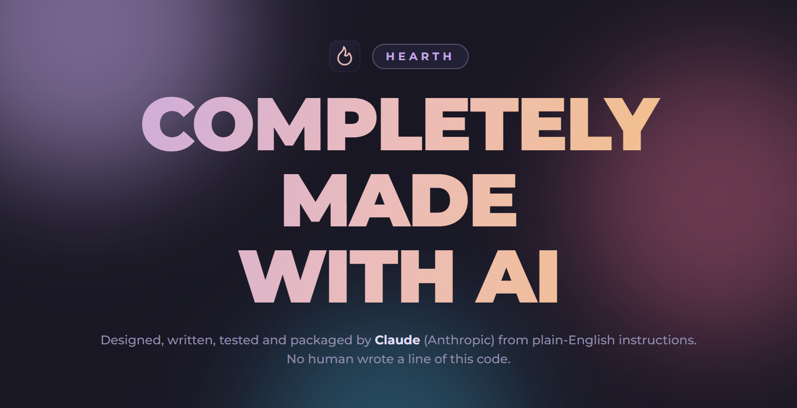
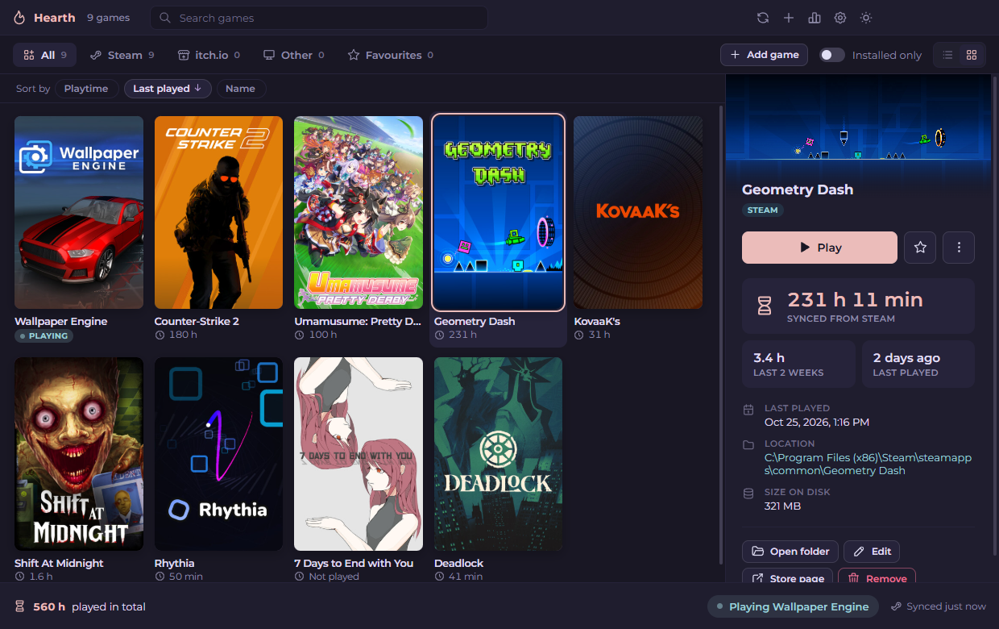
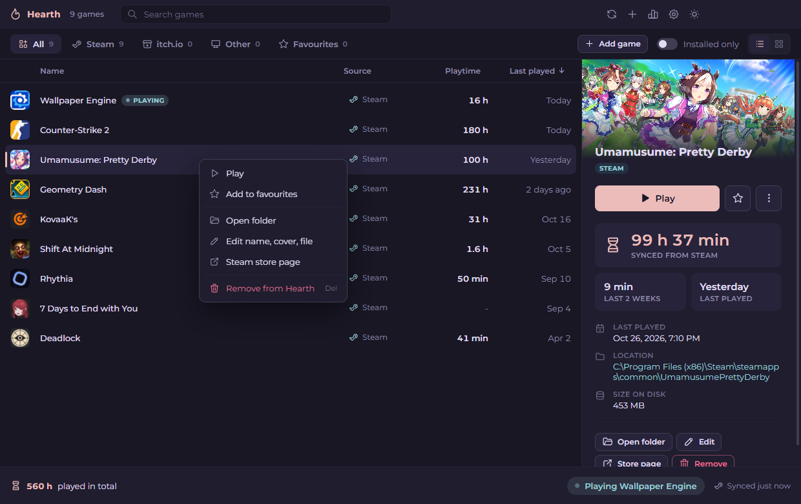
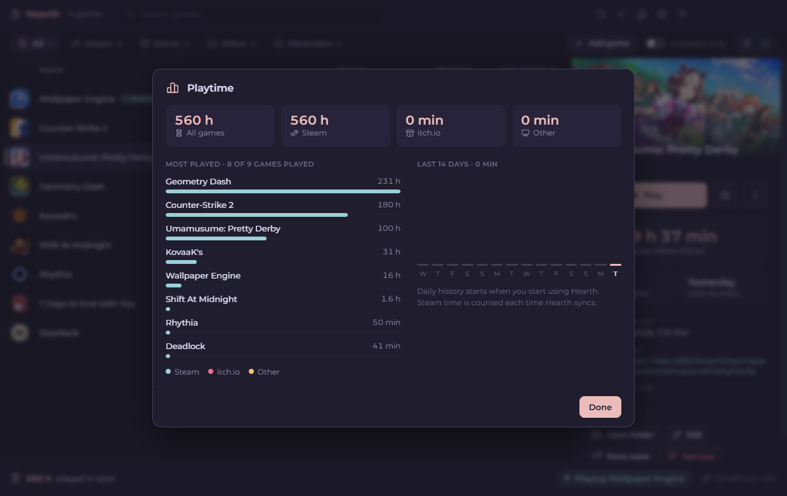
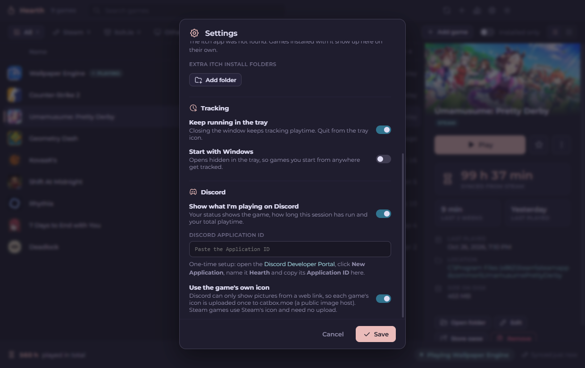
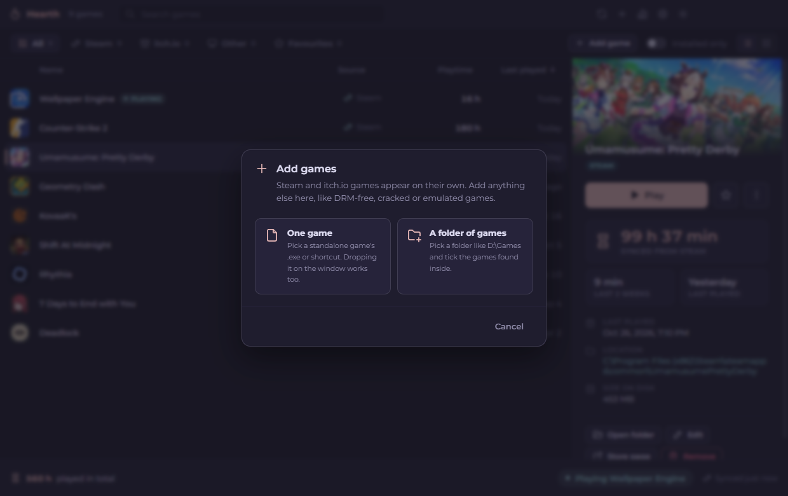
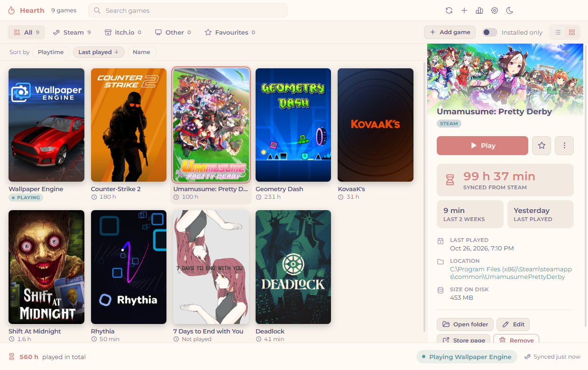

<div align="center">



</div>

<div align="center">

# Hearth

</div>

<div align="center">

One library for every game on your PC: Steam, itch.io and everything else, with your playtime for all of them  
**Every line of it was written by AI.**

</div>

<div align="center">

[](https://github.com/phsrp/hearth/releases/latest)  

</div>

## What's inside

- **Every game in one place:** Steam and itch.io games show up on their own. Everything else (DRM-free, standalone, cracked or emulated games) you add yourself.
- **Steam playtime sync:** Hearth reads your playtime straight from Steam's files, no login needed. Add a free Steam Web API key to also see exact playtime for games you own but don't have installed.
- **Playtime for everything else:** Hearth notices when a game is running, even if you didn't start it from Hearth, and counts the time. Already played a game before Hearth? Set its playtime and tracking carries on from there.
- **Discord status:** shows the game you're playing, how long this session has run and your total playtime, with the game's own icon. Only for games Discord doesn't already show, so you never get two.
- **Add standalone games easily:** click **Add game** and pick the .exe, drop an .exe or shortcut on the window, or point Hearth at a folder like `D:\Games` and tick the games it finds inside.
- **Remove anything:** right-click a game and choose **Remove from Hearth** (or press Delete). Steam and itch.io games stay removed after rescans, and you can bring them back from Settings.
- **Covers and list view:** a cover grid with Steam's library art, or a compact list sorted by playtime, last played, name or store
- **Playtime stats:** total playtime per store, your most played games and the last 14 days
- **Favourites, search, custom names and covers** for any game
- **Runs in the tray** so tracking keeps going with the window closed, and it can start with Windows
- **Updates itself:** checks for a new version every time it starts
- **Themes:** Rosé Pine and Rosé Pine Dawn

## Previews

<div align="center">



 

 



</div>

## How to download

1. Open the [latest release](https://github.com/phsrp/hearth/releases/latest) (the purple **download** button at the top of this page does the same).
2. Under **Assets**, pick one:
   - `Hearth-Setup-<version>.exe` installs Hearth and puts it in your Start menu.
   - `Hearth-Portable-<version>.exe` runs straight away without installing anything (handy on a USB stick).
3. Run the file you downloaded.
4. **If Windows says "Windows protected your PC":** the app is not code-signed yet, so Windows is careful with it. Click **More info**, then **Run anyway**.

### Updating

Hearth checks for a new version every time it starts.

- **Setup version:** the update downloads in the background. A bar at the top tells you when it's ready; click **Restart now**, or it installs the next time you close Hearth from the tray.
- **Portable version:** it can't update itself, so the bar links you to the new download. Replace the old Portable file with the new one.

You can also check by hand in **Settings → Updates**. Your library and playtime are always kept. (Auto updates start from version 1.0.1. If you have 1.0.0, download the new version once by hand.)

## Setting up Discord status

Discord needs an "application" to show a status, and you make one once:

1. Open the [Discord Developer Portal](https://discord.com/developers/applications) and click **New Application**.
2. Name it **Hearth** (this name is what Discord shows under your profile) and click **Create**.
3. Copy the **Application ID**.
4. In Hearth, open **Settings** (the gear at the top), paste it into **Discord application ID** and click **Save**.

Start a game and your Discord status shows it.

Hearth only steps in for games Discord doesn't already show. If Discord recognises the game by itself, or the game sets its own Discord status, Hearth leaves it alone so you don't get two. To change that for one game, open **Edit** and set **Discord status** to **Always** or **Never**. To show Hearth's status for every game, turn off **Skip games Discord already shows** in Settings. Steam games use Steam's icon. For other games Discord can only show a picture that's on the web, so Hearth uploads each game's icon once to [catbox.moe](https://catbox.moe) (a public image host). Turn off **Use the game's own icon** in Settings if you'd rather not.

## Getting exact Steam playtime (optional)

Without this, Hearth already reads the playtime Steam keeps on your PC. With it, Hearth also lists the games you own but haven't installed, with their playtime.

1. Get a free key at [steamcommunity.com/dev/apikey](https://steamcommunity.com/dev/apikey) (any domain name works, for example `localhost`).
2. In Hearth, open **Settings** and paste it into **Steam Web API key**. Your SteamID is filled in for you.
3. Click **Test connection**, then **Save**.

Your Steam profile's **Game details** need to be set to **Public** for this to work.

## What the version numbers mean

Every version is three numbers separated by dots, for example **1.0.0**:

```
  1   .   0   .   0
  │       │       └── minor update: fixes and small improvements
  │       └────────── major update: a big batch of new features (counts from 0 to 9)
  └────────────────── goes up by one when the major number would pass 9
```

- **Minor update (the last number)** goes up for small changes: bug fixes, polish, small additions. `1.0.0` → `1.0.1`.
- **Major update (the middle number)** goes up for a big update with new features, and the minor number starts again from 0. `1.0.1` → `1.1.0`. It counts from 0 up to 9.
- **The first number** only changes when the major number runs out: after `1.9.x` the next big update is `2.0.0`.

So a bigger number on the left always means a newer version: `1.0.1` is newer than `1.0.0`, and `1.1.0` is newer than `1.0.9`.

## Keyboard shortcuts

| Key | What it does |
| --- | --- |
| Start typing, or Ctrl+F | Search |
| Arrow keys | Move through your games |
| Enter | Play the highlighted game |
| Delete | Remove the highlighted game from Hearth |
| Ctrl+N | Add games |
| F5 | Rescan and sync Steam playtime |

## How playtime is counted

- **Steam games:** the playtime Steam itself records, read from your PC and (with an API key) from Steam's servers. Hearth never adds its own time to Steam games, so nothing is counted twice.
- **itch.io games:** whichever is higher, the itch app's own count or Hearth's.
- **Other games:** counted by Hearth while the game is running. Any program running from the game's folder counts, so games that start through their own launcher are tracked too. Games sitting loose in a shared folder (like your Desktop) only count when their exact .exe runs.

Hearth can only count time while it's running, so keep **Keep running in the tray** on, or turn on **Start with Windows**.

## Built with

- [Electron](https://www.electronjs.org/)
- Windows PowerShell for watching running games and extracting icons
- [Montserrat](https://github.com/JulietaUla/Montserrat) font (SIL Open Font License)
- [Tabler Icons](https://tabler.io/icons) (MIT)
- [Rosé Pine](https://rosepinetheme.com/) colours (MIT)
- Same look as [Petal Uninstaller](https://github.com/phsrp/petal-uninstaller)
